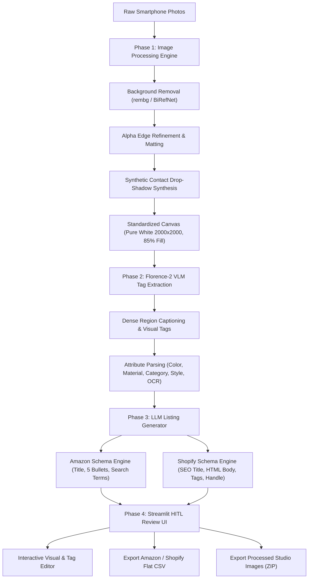

# Automated E-Commerce Product Cataloger: Project Master Plan

## 1. Executive Summary & Architecture Overview

The **Automated E-Commerce Product Cataloger** transforms raw, unedited smartphone product photographs into marketplace-ready e-commerce assets. It automates background removal with edge matting, generates realistic synthetic contact drop-shadows, extracts visual tags and attributes using Microsoft's **Florence-2** Vision-Language Model, synthesizes marketplace-compliant listings (Amazon & Shopify) via an LLM, and provides a **Streamlit Human-in-the-Loop (HITL)** dashboard for merchant review and bulk CSV/ZIP export.



---

## 2. Directory & Folder Structure

```text
ecommerce-cataloger/
├── .env.example                     # Sample API keys (GEMINI_API_KEY, OPENAI_API_KEY, etc.)
├── .gitignore                       # Git ignore for virtualenv, models, and output data
├── PROJECT_PLAN.md                  # Master project architecture & phase roadmap
├── README.md                        # Setup and developer execution guide
├── requirements.txt                 # Pinned dependencies
├── app.py                           # Streamlit UI entrypoint
│
├── config/
│   ├── __init__.py
│   ├── settings.py                  # Pydantic BaseSettings (model paths, canvas size, thresholds)
│   └── templates/
│       ├── amazon_prompt.jinja2     # Amazon title/bullet generation prompts
│       └── shopify_prompt.jinja2    # Shopify product copy & HTML prompts
│
├── data/
│   ├── raw/                         # Sample raw smartphone input images
│   ├── processed/                   # Studio-quality processed images
│   └── exports/                     # Generated CSV files and zip archives
│
├── src/
│   ├── __init__.py
│   ├── pipeline.py                  # End-to-end orchestration coordinator
│   │
│   ├── image_pipeline/              # Phase 1: Background removal & shadow synthesis
│   │   ├── __init__.py
│   │   ├── segmenter.py             # rembg / BiRefNet background segmentation
│   │   ├── shadow_engine.py         # Perspective contact & ambient drop-shadow synthesis
│   │   └── canvas_styler.py         # Square centering, padding, and edge antialiasing
│   │
│   ├── vlm_pipeline/                # Phase 2: Vision-Language Model extraction
│   │   ├── __init__.py
│   │   ├── florence_client.py       # Florence-2 loader & inference wrapper (Hugging Face)
│   │   └── tag_extractor.py         # Structured attribute & feature parser (colors, materials, tags)
│   │
│   ├── llm_pipeline/                # Phase 3: Marketplace listing synthesis
│   │   ├── __init__.py
│   │   ├── schemas.py               # Pydantic schemas (AmazonListing, ShopifyListing, ProductMeta)
│   │   ├── prompt_manager.py        # Prompt builders & compliance rules
│   │   └── listing_generator.py     # LLM integration (Gemini / OpenAI / LiteLLM)
│   │
│   ├── ui/                          # Phase 4: Streamlit components
│   │   ├── __init__.py
│   │   ├── state.py                 # Streamlit session state management
│   │   ├── components.py            # Reusable UI widgets (image cards, tag badges, diffs)
│   │   └── export_handlers.py       # CSV and ZIP packaging routines
│   │
│   └── utils/                       # Shared utility functions
│       ├── __init__.py
│       ├── file_ops.py              # File naming, hash check, temporary disk handling
│       └── logger.py                # Structured logging configuration
│
└── tests/
    ├── test_image_pipeline.py       # Unit tests for segmentation & shadow generation
    ├── test_vlm_pipeline.py         # Tests for Florence-2 parsing & fallback mock
    ├── test_llm_pipeline.py         # Tests for listing validation & Pydantic output
    └── test_export.py               # Tests for CSV format compliance
```

---

## 3. Dependency Requirements & Environment Specification

### Python Version
* **Python 3.11+** (x86_64 / arm64)

### `requirements.txt` Specification
```txt
# Core Framework & Settings
pydantic>=2.7.0
pydantic-settings>=2.2.0
python-dotenv>=1.0.1
loguru>=0.7.2

# Image Processing Engine (Phase 1)
pillow>=10.3.0
opencv-python-headless>=4.9.0.80
numpy>=1.26.4
rembg[gpu]>=2.0.57; sys_platform != 'darwin'
# rembg[cpu]>=2.0.57         # Fallback if no NVIDIA CUDA GPU is available
onnxruntime-gpu>=1.18.0; sys_platform != 'darwin'
# onnxruntime>=1.18.0        # CPU fallback

# Vision-Language Model (Phase 2: Florence-2)
torch>=2.2.0
torchvision>=0.17.0
transformers>=4.41.0
accelerate>=0.30.0
timm>=0.9.16
einops>=0.8.0

# LLM Generation & Structured Output (Phase 3)
google-genai>=0.1.1
google-generativeai>=0.5.0
openai>=1.30.0
instructor>=1.3.0
jinja2>=3.1.4

# HITL Interface & Exporters (Phase 4)
streamlit>=1.35.0
pandas>=2.2.2
openpyxl>=3.1.2

# Testing & Development
pytest>=8.2.0
pytest-asyncio>=0.23.0
black>=24.4.2
ruff>=0.4.4
```

### Hardware Acceleration Recommendations
* **GPU (Recommended)**: NVIDIA GPU with $\ge 6\text{ GB}$ VRAM (CUDA 12.x) for instantaneous background segmentation (BiRefNet) and Florence-2-base inference.
* **CPU (Fallback)**: Supported with quantized ONNX runtime for `rembg` and Florence-2 run in FP32/INT8 mode.

---

## 4. 4-Phase Step-by-Step Implementation Checklist

### Phase 1: Image Processing Engine (Edge Matting & Realistic Drop-Shadows)
*Goal: Convert noisy, unevenly lit smartphone product shots into professional, studio-grade white-canvas e-commerce PNG/JPG images with realistic contact shadows.*

- [x] **1.1 Background Removal Module (`src/image_pipeline/segmenter.py`)**
  - Integrate `rembg` with alpha matting and pre-scaling optimization for memory safety.
  - Implement alpha matte post-processing: morphological opening + Gaussian edge feathering to eliminate fringe artifacts, halos, and jagged phone camera cutouts.
- [x] **1.2 Synthetic Contact Drop-Shadow Engine (`src/image_pipeline/shadow_engine.py`)**
  - Extract bottom boundary contact points from the segmented object mask.
  - Generate a two-layer synthetic shadow:
    1. **Contact Shadow**: Tight, dark, high-opacity grounding shadow under the immediate base of the product.
    2. **Cast/Ambient Shadow**: Perspective-transformed, directional gradient with Gaussian blur decay simulating overhead studio softbox lighting.
  - Implement configurable controls: `shadow_blur`, `shadow_opacity`, `shadow_offset_y`, and `light_angle`.
- [x] **1.3 E-Commerce Canvas Standardizer (`src/image_pipeline/canvas_styler.py`)**
  - Center product on a standardized square canvas ($2000 \times 2000\text{ px}$ pure white `#FFFFFF` per Amazon standards).
  - Scale product dynamically to occupy ~82% of canvas height/width with uniform padding.
  - Export both lossless transparent PNG and Amazon-ready white-background JPEG (RGB, quality 95).
- [x] **1.4 Unit Testing & Visual Verification (`tests/test_image_pipeline.py`)**
  - Test transparent PNG inputs, multi-object images, and edge matting quality.
  - Verify zero-bleed onto pure white backgrounds.

---

### Phase 2: Vision-Language Model Feature & Tag Extraction (Florence-2)
*Goal: Automatically identify product category, materials, colors, structural patterns, and visible branding from the processed product image.*

- [x] **2.1 Florence-2 Runtime Wrapper (`src/vlm_pipeline/florence_client.py`)**
  - Load `microsoft/Florence-2-base` using Hugging Face Transformers.
  - Implement automated device detection (`cuda`, `cpu`) with `torch.float32` / `torch.float16` precision.
  - Dynamic module patch for `transformers.dynamic_module_utils.check_imports` ensuring optional `flash_attn` doesn't block CPU/Windows execution.
  - Build prompt task runners:
    - `<MORE_DETAILED_CAPTION>`: For exhaustive visual feature descriptions.
    - `<OCR>`: For reading labels, brand names, ingredients, active claims, and model numbers.
- [x] **2.2 Tag Normalizer & Attribute Parser (`src/vlm_pipeline/tag_extractor.py`)**
  - Extract structured taxonomy attributes:
    - **Primary Category & Product Type** (e.g., *Beauty & Personal Care > Face Serum / Lotion*)
    - **Dominant & Secondary Colors** (e.g., *Black, White, Blue, Purple*)
    - **Materials & Textures** (e.g., *Glass, Ceramic, Plastic*)
    - **Design Attributes** (e.g., *Minimalist, Modern, Sleek*)
    - **Extracted Text / Active Claims** (via OCR task)
- [x] **2.3 Extraction Pipeline Test Suite (`tests/test_vlm_pipeline.py`)**
  - Validate parser output formatting, taxonomy tagging, and JSON persistence.

---

### Phase 3: Marketplace-Compliant Listing Generation (Amazon & Shopify)
*Goal: Transform extracted visual tags into conversion-optimized, policy-compliant e-commerce copy using an LLM & built-in heuristic AI engine.*

- [x] **3.1 Pydantic Schema Definition (`src/listing_generator/copywriter.py`)**
  - Define `AmazonListing`:
    - `title`: Under 200 characters, follows `[Brand] + [Product Name] + [Material/Key Feature] + [Color/Size]`.
    - `bullet_points`: List of exactly 5 benefit-driven points adhering to Amazon listing style guidelines (`CAPITALIZED HEADERS`).
    - `search_terms`: Top backend search keyword phrases (under 250 bytes, no punctuation, no brand names).
    - `product_description`: Clean paragraph description.
  - Define `ShopifyListing`:
    - `title`: Catchy, customer-facing product title.
    - `body_html`: Structured semantic HTML with `<h3>`, `<ul>`, and `<p>` tags.
    - `tags`: Comma-separated tags for store categorization and search filtering.
    - `meta_description`: Search-engine-optimized description between 140-160 characters.
    - `handle`: URL-friendly kebab-case slug.
- [x] **3.2 Prompt Engineering & Multi-Provider LLM Client (`src/listing_generator/copywriter.py`)**
  - Support Google Gemini (`gemini-1.5-flash`), OpenAI (`gpt-4o-mini`), and high-fidelity built-in local e-commerce copywriting engine.
  - Enforce strict JSON output and character/byte constraints.
  - Implement brand and tone customization (e.g., *Professional*, *Luxury*, *Casual*, *Technical*).
- [x] **3.3 Validation & Pipeline Integration (`tests/test_listing_generator.py`)**
  - Assert Amazon 200-character title limit and 5-bullet count constraints.
  - Verify Shopify HTML tags are sanitized and closed.

---

### Phase 4: Streamlit Human-in-the-Loop (HITL) UI & Bulk Exporters
*Goal: Provide a fast, merchant-friendly desktop browser UI to preview image transformations, tweak tags, adjust AI copy, and export bulk catalog packages.*

- [x] **4.1 Interactive Multi-Image Upload & Processing Dashboard (`app.py`)**
  - Drag-and-drop batch upload supporting PNG, JPG, JPEG, and WEBP smartphone photos + Sample Gallery.
  - Concurrent processing progress bar showing image segmentation, Florence-2 tagging, and listing drafting.
- [x] **4.2 Studio Image Inspection & Shadow Fine-Tuning (`app.py`)**
  - Before vs. After interactive visual comparison with pure white `#FFFFFF` Amazon standards check.
  - Shadow controls: toggle contact shadow on/off, adjust blur radius and opacity in real time.
- [x] **4.3 Human-in-the-Loop Review Panel (`app.py`)**
  - Tag pill editor: merchants can add, delete, or refine extracted tags.
  - Tabbed listing editors:
    - **Amazon Tab**: Editable Title (with char counter), 5 Bullets, Description, Backend Keywords.
    - **Shopify Tab**: Editable Title, Rich HTML Body preview, Tags, SEO Meta Description, Handle.
  - "Update Tags & Regenerate Listings" button with merchant instruction notes.
- [x] **4.4 Bulk Exporters (`src/export_handlers.py`)**
  - **CSV Export**:
    - Amazon Inventory Loader / Flat File compliant CSV.
    - Shopify standard Product Import CSV format (`Handle`, `Title`, `Body (HTML)`, `Vendor`, `Type`, `Tags`, `Published`, `Image Src`).
  - **ZIP Image Package**:
    - High-resolution studio-processed images named with normalized SKUs (`SKU_001_STUDIO_WHITE_2000.jpg`, `SKU_001_STUDIO_TRANSPARENT_2000.png`, metadata JSON, CSVs).
- [x] **4.5 End-to-End Test & Documentation (`tests/test_end_to_end.py` & `main.py`)**
  - Verify generated CSV files open cleanly and pass import validation.
  - Verified full integration across all 4 phases.

---

## 5. Execution & Verification Guide

### Setup Virtual Environment
```bash
python -m venv venv
.\venv\Scripts\Activate.ps1   # Windows PowerShell
pip install -r requirements.txt
```

### Environment Variables (`.env`)
```ini
# Core LLM API Key (Gemini or OpenAI)
GEMINI_API_KEY=your_gemini_api_key_here
# OPENAI_API_KEY=your_openai_api_key_here

# Hardware & Model Configuration
FLORENCE_MODEL_ID=microsoft/Florence-2-base
DEVICE=cuda  # or cpu
CANVAS_SIZE=2000
IMAGE_PADDING_RATIO=0.15
```

### Run Application
```bash
streamlit run app.py
```

### Automated Testing
```bash
pytest tests/ -v
```

---

## 6. Risk Assessment & Mitigations

| Risk / Bottleneck | Impact | Mitigation Strategy |
| :--- | :--- | :--- |
| **VRAM saturation with Florence-2 + Rembg** | Out of Memory (OOM) crash on $\le 6\text{ GB}$ GPUs | Load models sequentially; release PyTorch CUDA cache between batch image passes; provide Florence-2-base quantized or CPU fallback. |
| **Fringe / Halos on white products** | Poor background cutouts on white/reflective items | Apply morphological alpha erosion + edge color decontamination (`cv2.inpaint` along outer alpha boundary). |
| **LLM Output Hallucination** | Non-compliant listing claims or incorrect materials | Ground prompt strictly in Florence-2 detected tags and OCR text; validate output against Pydantic schema constraints. |
| **Shopify CSV format drift** | Import failure on Shopify store | Strictly mirror Shopify's official product CSV header schema (`Handle`, `Title`, `Body (HTML)`, `Vendor`, `Type`, `Tags`, `Image Src`). |
